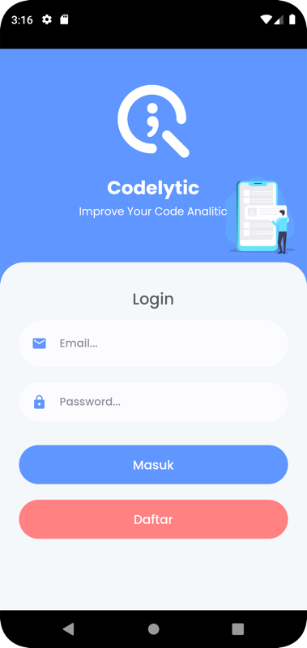
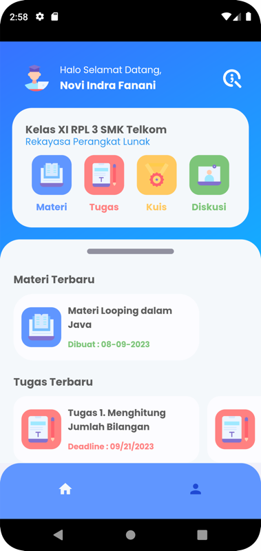
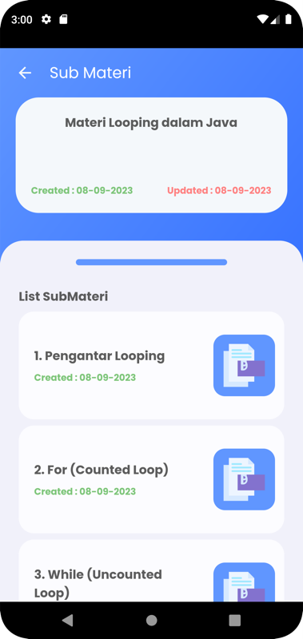
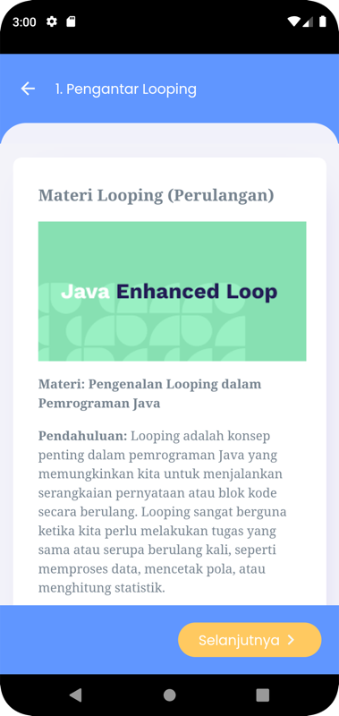
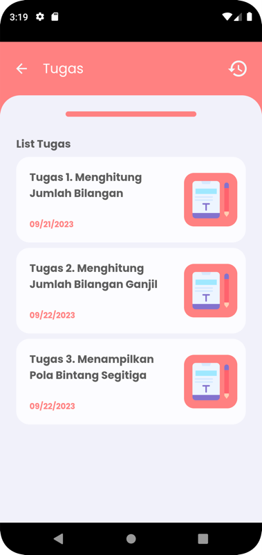
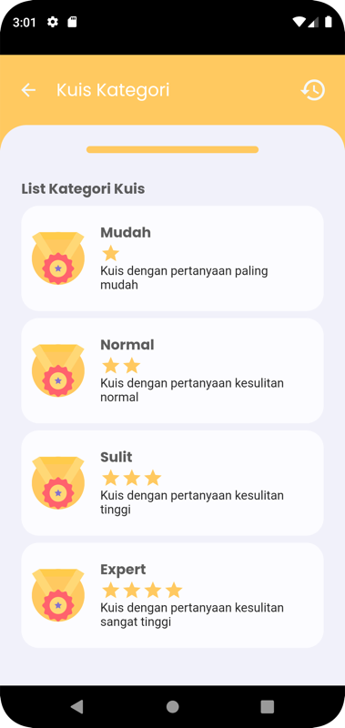
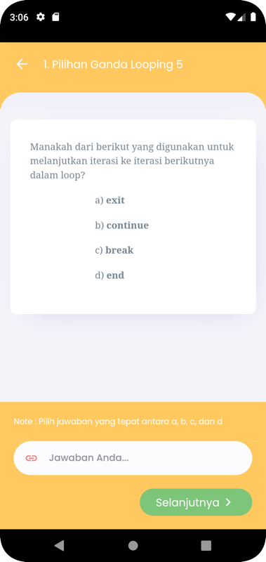
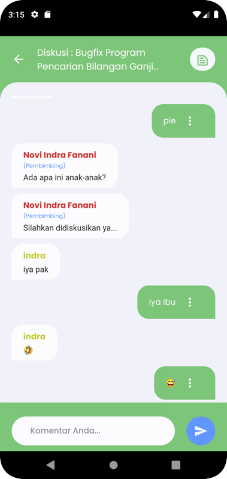

# Codelytic – Student Mobile App

Codelytic is a mobile learning app for programming classes. Students join their teacher's class with a code, study materials chapter by chapter, submit tasks, take quizzes by difficulty level and discuss in groups. Built with **Flutter** using **Clean Architecture** and **BLoC**.

The backend and teacher dashboard live in [NoviIndraF/codelytic](https://github.com/NoviIndraF/codelytic).

<p>
  
  
  
  
</p>
<p>
  
  
  
  
</p>

## Features

- **Onboarding, register and login**, with the session kept on the device.
- **Join a class** with the code from the teacher.
- **Home:** class info, the latest materials and tasks, and shortcuts to Materials, Tasks, Quizzes and Discussions.
- **Materials:** list of materials and their chapters; chapter content is rendered from the backend.
- **Tasks:** task details with deadline, submit an answer link, and see the submission history.
- **Quizzes:** quiz categories by level (Easy, Normal, Hard, Expert), question-by-question answering, quiz history and answer details.
- **Discussions:** join a discussion group by code and chat with the group and teacher.
- **Profile:** view and edit the student profile, log out.

## Tech stack

| Area | Packages |
|---|---|
| State management | `flutter_bloc`, `bloc`, `equatable` |
| Dependency injection | `get_it` |
| Networking | `dio`, `http` |
| Functional error handling | `dartz` (`Either`) |
| Local storage | `shared_preferences` |
| UI | `google_fonts`, `flutter_svg`, `lottie`, `carousel_slider`, `introduction_screen`, `webview_flutter` |
| Forms | `form_validator`, `form_validation` |

## Architecture

```
lib/
  common/          Routes, theme, constants (API base URL), helpers
  data/
    datasource/    Remote data sources (one per feature) and SharedPreferences
    model/         Request and response models
    repositories/  Repository implementations
  domain/
    entities/      Entities used by the UI
    repositories/  Repository contracts
    usecase/       One use case class per feature
  presentation/
    bloc/          auth, home, room, materi, task, quiz, discussion, student
    pages/         Screens per feature
    widgets/       Reusable list items, chat bubbles, cards
  injection.dart   get_it setup
  main.dart
```

## Getting started

Requirements: Flutter with Dart 2.19.6 or newer, and an Android emulator or device.

1. Run the backend from [codelytic](https://github.com/NoviIndraF/codelytic).
2. Set the API base URL in `lib/common/constant.dart`:
   ```dart
   static const baseUrl = "http://10.0.2.2:8000/api/"; // Android emulator → local backend
   ```
3. Install and run:
   ```bash
   flutter pub get
   flutter run
   ```
